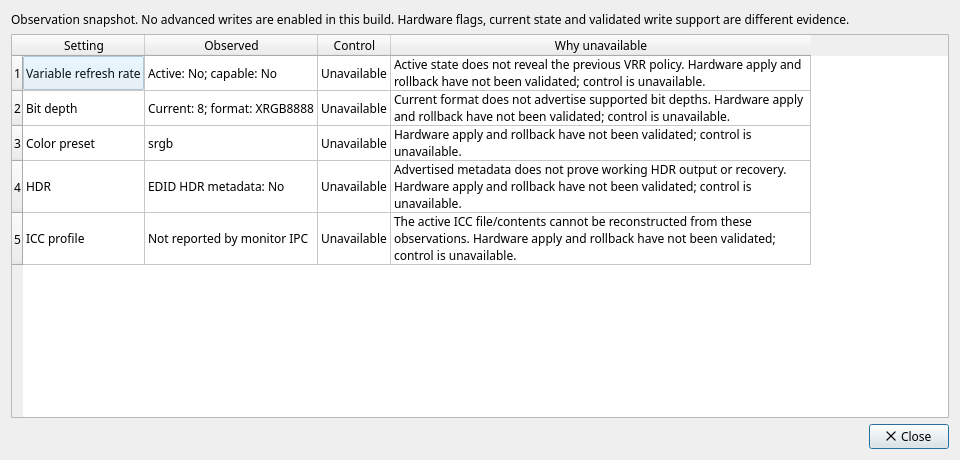

# Monarch

A native Python and Qt monitor manager for Hyprland, with visual layout editing,
Lua integration, guarded previews, and explicit save-on-login configuration.

**Status: Phase 7 testing candidate — `0.1.0rc1`.**
Named profiles, guarded quick switching and opt-in automatic previews are available.
Physical dock/resume acceptance remains open in the tracker. There is no stable
release or AUR submission. A native Arch testing package can now be built or
downloaded from successful CI runs. See the [installation/testing guide](docs/testing-guide.md).



## Install and test

For Arch/Garuda, follow the [candidate installation guide](docs/testing-guide.md).
The package supplies a **Monarch** application-menu entry, icon and tray. Native
Qt dependencies come from the distro. Offline help is available in the GUI and
through `monarch help`; [license notices](THIRD_PARTY_NOTICES.md) accompany the build.
This is the feedback candidate, not a tagged stable release.

## Run the editor

Requires Linux, Python 3.12+, and a running Hyprland session with `hyprctl` on PATH.
From a checkout, using [uv](https://docs.astral.sh/uv/):

```sh
uv run --extra gui monarch gui
```

Alternatively, install the checkout's GUI extra in a virtual environment with
`python -m pip install '.[gui]'`, then run `monarch gui`. The distribution name is
`monarch-displays`; these commands install this checkout, not a PyPI release.

The GUI can inspect and draft edits immediately. **Set up monitor management**
previews a managed Lua include and the current baseline before requesting approval.
Applying requires a verified owned or explicitly registered configuration. Existing
config files are not silently adopted. Read the [editor guide](docs/phase-3-guide.md)
before enabling integration, especially its basic-settings and reload contract.

Use **Appearance** to follow the system Qt theme or choose an available installed
style. Compatible qt6ct/Kvantum/Breeze plugins are detected when available.
See the [profiles and appearance guide](docs/phase-4-guide.md).

Use **Automation…** to select eligible profiles and explicitly enable matching.
Automatic previews still require Keep/Revert. Login startup is a separate opt-in.
See the [automation guide](docs/phase-5-guide.md).

Use **Advanced settings…** for observed VRR/format/color/HDR state and explicit
write limitations. **Help → Redacted diagnostics…** or `monarch diagnose` collects
a support report. Advanced writes remain unavailable pending hardware recovery
evidence; [Phase 6 guide](docs/phase-6-guide.md) explains the stricter basic-state gate.

## Available now

- Read-only advanced observations, compatibility explanations and gated writes.
- Redacted GUI/CLI diagnostics with explicit private exports and conflict actions.
- Tagged mirror-ID resolution with refusal of unknown targets.
- Opt-in exact/subset topology matching, priorities, tie/no-match preservation.
- Shared manual pin/resume, debounce, retry limits and a single automatic session owner.
- Automatic guarded previews and explicit XDG autostart controls.
- Named profiles: observed/draft capture, CRUD, versioned import/export and a quick selector.
- Stable identity matching with explicit mappings for ambiguous displays.
- Guarded GUI/keybinding/terminal switching and optional `monarch gui --tray`.
- Native Qt system themes and installed widget-style selection.
- Proportional canvas with drag snapping, keyboard movement, and exact coordinates.
- Enable/disable, advertised resolution/refresh, scale, transforms, and mirroring.
- Separate observed and draft state, inline validation, and preserved stale edits
  when monitors or external settings change.
- Temporary per-output identification and system-palette light/dark rendering.
- Keep/Revert with a visible countdown and a separate recovery guard process.
- Runtime-only confirmation or save-on-login persistence after Keep.
- Reviewed desktop include installation, private backups, pinned config files,
  explicit re-review after changes, and conflict/stale-session protection.
- Read-only CLI discovery and guarded CLI primitives alongside the GUI.

The current write baseline is a clean Hyprland 0.57.2 Lua release. Default XDG
config targets additionally require the verified hyprutils search implementation;
other setups remain inspectable. Advanced HDR, VRR, color and custom modeline
rules are outside the desktop integration contract. Active VRR, non-8-bit formats,
non-sRGB/default SDR state or unknown required observations block the basic guard.
Advanced writes are explicitly deferred. [Release gates](docs/release-checklist.md)
remain open for physical/user acceptance; candidate packaging is available.

## Validation

Automated Qt tests use an offscreen backend. Native Qt/Wayland acceptance runs
inside a disposable compositor with two virtual outputs at different fractional
scales. Read-only GUI startup was also checked on a physical three-output desktop.
Those are separate evidence layers: physical mode changes, docking/resume,
hardware failure recovery and the full release matrix are not certified.

- [Phase 7 packaging evidence](docs/phase-7-report.md)
- [Testing and feedback](docs/testing-guide.md)
- [Phase 6 evidence and advanced-write deferrals](docs/phase-6-report.md)
- [Phase 5 evidence and open hardware gate](docs/phase-5-report.md)
- [Phase 4 evidence](docs/phase-4-report.md)
- [Phase 3 evidence](docs/phase-3-report.md)
- [Phased implementation plan](docs/implementation-plan.md)
- [Progress tracker](docs/progress.md)
- [Architecture](docs/architecture.md)
- [Compatibility research](docs/compatibility.md)
- [Validation strategy](docs/validation.md)
- [Historical Phase 2 CLI guide](docs/phase-2-guide.md)

## Read-only CLI

```sh
uv run monarch inspect
uv run monarch inspect --json
uv run monarch inspect --watch
```

No Qt dependency is required for these commands. Reports redact monitor identities
and config paths by default; `--show-identifiers` includes them for local use.
Watch mode emits event-driven updates and remains bound to the original session
signature. A replacement compositor requires a new invocation. Inspection never
applies settings or reloads configuration.

## Development

```sh
uv sync --locked --extra gui --group gui-dev
uv run --extra gui --group gui-dev ruff check .
uv run --extra gui --group gui-dev ruff format --check .
uv run --extra gui --group gui-dev mypy
QT_QPA_PLATFORM=offscreen uv run --extra gui --group gui-dev pytest
uv build
```

The Qt dependency is PySide6/Qt 6. Native probes require Wayland and render access:

```sh
uv run --extra gui --group gui-dev python tools/probe_gui.py
uv run --extra gui --group gui-dev python tools/probe_profiles.py
uv run --extra gui --group gui-dev python tools/probe_automation.py
uv run --extra gui --group gui-dev python tools/probe_compatibility.py
uv run python tools/probe_recovery.py
```

Each probe creates its own nested compositor and virtual outputs. Parent monitor
settings are not changed. See [contributing](CONTRIBUTING.md) for evidence rules.

## License

[MIT](LICENSE). Dependencies retain their licenses; distributed packages must
include the applicable Qt/PySide notices and comply with their terms.
