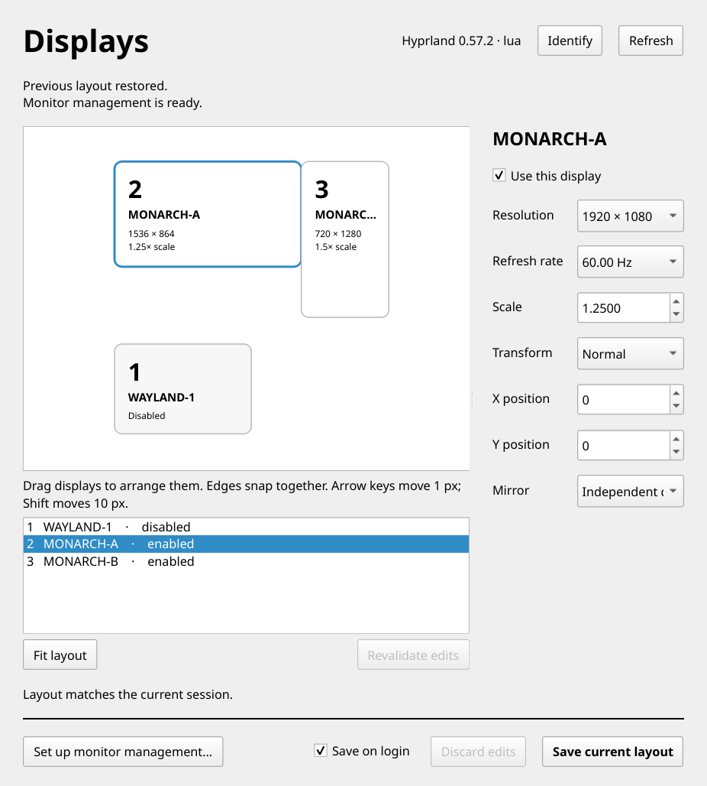

# Monarch

A native Python and Qt monitor manager for Hyprland, with visual layout editing,
Lua integration, guarded previews, and explicit save-on-login configuration.

**Status: Phase 3 implemented — manual-editor alpha (`0.1.0.dev3`).**
Profiles and quick switching follow in Phase 4; automatic profile selection is
Phase 5. There is no stable release or published Arch/AUR package yet.



## Run the editor

Requires Linux, Python 3.12+, and a running Hyprland session with `hyprctl` on PATH.
From a checkout, using [uv](https://docs.astral.sh/uv/):

```sh
uv run --extra gui monarch gui
```

Alternatively, install the checkout's GUI extra in a virtual environment with
`python -m pip install '.[gui]'`, then run `monarch gui`. The distribution name is
`monarch-displays`; these commands install this checkout, not a PyPI release.

The GUI can inspect and draft edits immediately. **Set up monitor management**
previews a managed Lua include and the current baseline before requesting approval.
Applying requires a verified owned or explicitly registered configuration. Existing
config files are not silently adopted. Read the [editor guide](docs/phase-3-guide.md)
before enabling integration, especially its basic-settings and reload contract.

## Available now

- Proportional canvas with drag snapping, keyboard movement, and exact coordinates.
- Enable/disable, advertised resolution/refresh, scale, transforms, and mirroring.
- Separate observed and draft state, inline validation, and preserved stale edits
  when monitors or external settings change.
- Temporary per-output identification and system-palette light/dark rendering.
- Keep/Revert with a visible countdown and a separate recovery guard process.
- Runtime-only confirmation or save-on-login persistence after Keep.
- Reviewed desktop include installation, private backups, pinned config files,
  explicit re-review after changes, and conflict/stale-session protection.
- Read-only CLI discovery and guarded CLI primitives alongside the GUI.

The current write baseline is a clean Hyprland 0.57.2 Lua release. Default XDG
config targets additionally require the verified hyprutils search implementation;
other setups remain inspectable. Advanced HDR, VRR, color and custom modeline
rules are outside the desktop integration contract until later work. Profiles,
tray switching, automation and release packaging remain planned.

## Validation

Automated Qt tests use an offscreen backend. Native Qt/Wayland acceptance runs
inside a disposable compositor with two virtual outputs at different fractional
scales. Read-only GUI startup was also checked on a physical three-output desktop.
Those are separate evidence layers: physical mode changes, docking/resume,
hardware failure recovery and the full release matrix are not certified.

- [Phase 3 evidence](docs/phase-3-report.md)
- [Phased implementation plan](docs/implementation-plan.md)
- [Progress tracker](docs/progress.md)
- [Architecture](docs/architecture.md)
- [Compatibility research](docs/compatibility.md)
- [Validation strategy](docs/validation.md)
- [Historical Phase 2 CLI guide](docs/phase-2-guide.md)

## Read-only CLI

```sh
uv run monarch inspect
uv run monarch inspect --json
uv run monarch inspect --watch
```

No Qt dependency is required for these commands. Reports redact monitor identities
and config paths by default; `--show-identifiers` includes them for local use.
Watch mode emits event-driven updates and remains bound to the original session
signature. A replacement compositor requires a new invocation. Inspection never
applies settings or reloads configuration.

## Development

```sh
uv sync --locked --extra gui --group gui-dev
uv run --extra gui --group gui-dev ruff check .
uv run --extra gui --group gui-dev ruff format --check .
uv run --extra gui --group gui-dev mypy
QT_QPA_PLATFORM=offscreen uv run --extra gui --group gui-dev pytest
uv build
```

The Qt dependency is PySide6/Qt 6. Native probes require Wayland and render access:

```sh
uv run --extra gui --group gui-dev python tools/probe_gui.py
uv run python tools/probe_recovery.py
```

Each probe creates its own nested compositor and virtual outputs. Parent monitor
settings are not changed. See [contributing](CONTRIBUTING.md) for evidence rules.

## License

[MIT](LICENSE). Dependencies retain their licenses; distributed packages must
include the applicable Qt/PySide notices and comply with their terms.
