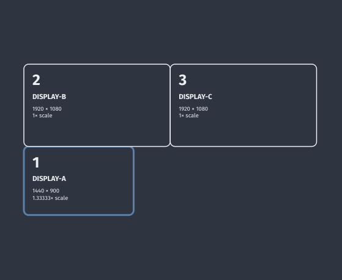

# 0.1.0rc2 feedback changes

Date: 2026-11-23. Testing candidate; no stable tag or release publication.

## Tray lifetime

The editor enables its tray by default. Closing to an available tray hides the
window while retaining drafts, the backend thread and existing monitor-event
watcher. Open Monarch or activate the tray icon to return. Quit Monarch explicitly
shuts down the worker and retains the independent guard's recovery behavior;
canceling a dirty-draft quit leaves the session running. During a preview, the
window and confirmation remain reachable until Keep/Revert completes. Without a
tray host, close exits normally; `monarch gui --no-tray` opts out explicitly.

Background lifetime does not enable automation or login startup. Existing hotplug
discovery continues while hidden, with the same stale-draft and ownership checks.
Automatically integrating/configuring a previously unknown external display is a
recorded future request, requiring its own placement, ownership and confirmation
policy. No root service or separate daemon is introduced.

## Canvas

Monitor outlines use the theme palette, falling back to a contrasting text color
when Mid/Highlight is transparent or indistinguishable from the fill. Cosmetic
pens keep their screen thickness when the canvas is scaled. This addresses flat
Nord-style palettes without changing the application's global theme.

Dragging snaps live to nearby display edges/alignment within 12 viewport pixels;
the tolerance is converted through the view zoom to logical monitor coordinates.
Targets far away on the perpendicular axis do not attract the moving monitor.
Hold Alt for free placement. Selecting a display without dragging does not snap
or move it. Numeric and keyboard placement remain precise.
Draft geometry is committed on release; dragging never applies a monitor change.

## Validation

- All 242 tests pass locally on Python 3.13, including live pointer snapping at two
  zoom levels, selection without movement, rendered outline contrast, tray draft retention/reopen/canceled Quit,
  no-host close, and explicit Quit during a real independent-guard preview.
- Ruff lint/format and strict mypy pass; source/wheel assets/checksums pass.
- Native system Python/PySide6 Qt Wayland with `qt6ct-style` and an available tray
  passed hide/reopen/explicit Quit and contrasting outlines using synthetic outputs.
  That native UI probe starts no monitor worker and changes no physical settings;
  the real worker and recovery tests use the existing synthetic subprocess backend.
- [Hosted CI on `3024b18`](https://github.com/Azazel55605/monarch/actions/runs/45224433000)
  passed all 242 tests on Python 3.12, 3.13 and 3.14 and through Arch makepkg/check.
  Actual pacman installation/removal and installed Qt/help/icon checks passed.
  Python and Arch candidate artifacts uploaded. The downloaded source/wheel/Arch
  checksums and source manifest passed verification; installed modules/resources
  match the code used for local and native checks.

The existing VRR setup/Preview blocker and earlier native output/mirror timeouts
remain open. This change does not claim physical modesetting, docking/resume or
fresh-login acceptance. Follow the [testing guide](testing-guide.md) for the next
user test and the [Phase 7 report](phase-7-report.md) for earlier evidence.
