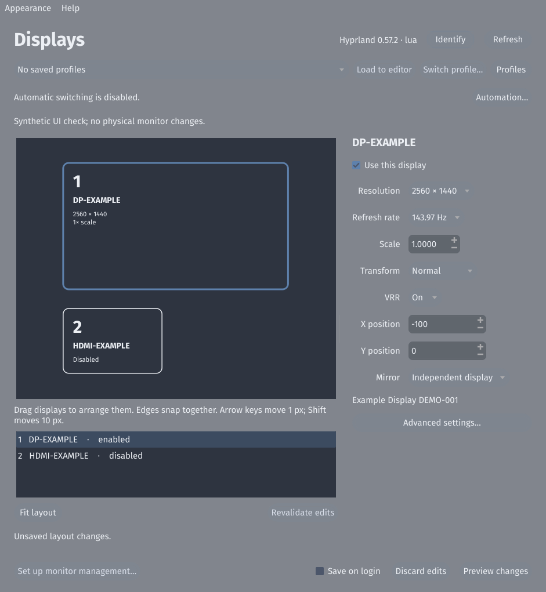

# VRR Off/On in 0.1.0rc4

This testing candidate supports per-monitor VRR **Off (0)** and **On (1)** through
Monarch's existing independent guard. Conditional fullscreen policies (2/3), HDR,
bit depth, color presets and ICC writes remain deferred. Off/On software recovery
is tested; target physical-panel behavior is an acceptance test, not certified by
virtual outputs or an EDID capability flag.

## Enable it

1. Quit the old Monarch instance and install the rc4 candidate. Run `monarch gui`.
2. Select the intended display and set **VRR → On** in its normal properties panel.
   On requires an explicit VRR-capable hardware flag and known observed state.
   Other displays retain their individually selected Off/On policies.
3. Preview and verify the display. Revert or timeout restores the previous policy
   and layout. Keep retains the chosen policy for the current session.
4. Check **Save on login** before Preview/Keep to persist the policy in the managed
   Lua module. A runtime-only Keep does not change startup configuration. Test the
   next login separately; opening the app itself does not apply settings.
5. Change position/scale while VRR is On and repeat Preview → Revert and Keep.
   Active VRR alone no longer blocks basic edits when the owned baseline matches.

Profiles contain each output's policy. Saved-profile load/switch, tray/terminal
switching and eligible automation still use the same mapping and confirmation
path; no VRR choice implies automatic Keep or persistence. Automation topology
rebasing retains known policy only for the same physical identity. Unknown extras
are captured only with a known inactive VRR state; active external policies are
not silently adopted.

## Initial migration and policy ownership

Layout schema 2 adds a mandatory integer `vrr` field with values 0 or 1. Legacy
schema-1 layouts/profiles belong to Monarch's prior basic-only, VRR-Off contract
and are interpreted as Off. Old module bytes remain readable and are not rewritten
on discovery. The first confirmed persistence writes explicit policies; the guard
retains its byte-exact prior-module backup. Profile catalogs get a private backup
before a nested legacy layout is rewritten. Old pending journals can still recover
using their original schema-1 candidate digests. Older Monarch builds reject the
new layout schema; do not downgrade while a preview/recovery is pending.

If a legacy or externally configured output is already active in VRR, Monarch
cannot infer its configured Off/On/conditional policy from that boolean. Establish
and review the inactive legacy baseline once before the first rc3 preview, then
use Monarch's explicit On policy. Re-review changed configuration dependencies via
setup when required. Do not edit generated Lua or delete recovery journals.

Both global `misc.vrr` and per-output rules can affect the result. Generated rc3
output rules explicitly include `vrr=0` or `vrr=1`, so their policy does not depend
on a global fallback. Hyprland 0.57.2's Lua API can merge fields into an existing
same-selector monitor rule; omission alone does not prove that an earlier rule was
cleared. Runtime output-management overrides can also affect the effective rule.
A config edit is not proof of live state.

Observed profile capture in the GUI uses only policy tied to the verified managed
baseline or a confirmed layout bound to the same compositor generation and file
hash. External active policy is not guessed. CLI capture can explicitly declare
an observed active output as On with `layout capture --vrr-on OUTPUT` or
`profile capture NAME --vrr-on OUTPUT`; these capture data and do not apply changes.
Conditional policies must not be represented as always-On without that explicit
choice. For another target policy, edit a draft or strict schema-2 JSON.

## Hyprland 0.57.2 VRR-only update fix (rc4)

A physical test of rc3 failed with an acknowledged but unobserved VRR-only change;
the journal confirmed rollback completed. Its synthetic transport had applied VRR
immediately and did not reproduce the compositor's cached active-rule behavior.
In tagged 0.57.2 the rule comparison omits VRR, and the property refresher evaluates
VRR before the newly scheduled monitor rule is adopted. A VRR-only edit can therefore
leave the previous active policy in effect despite an `ok` response.

The guard now refreshes an enabled, independent VRR-capable output when adopting
its policy after a reload or changing that policy. It sends a temporary position
one logical pixel away, verifies the intermediate geometry/identity with supported
SDR state, then sends the final rule to restore the exact requested position and
trigger VRR with the adopted policy. Final VRR verification remains mandatory.
The tiny intermediate movement may be visible. It does not alter global options,
work-area reservations, saved files, resolution, scale or transform to force a
refresh. Every step repeats session, ownership, topology and automation checks;
the existing journal covers rollback if a stage fails. Mirrored/disabled outputs
do not use this independent-output refresh path.

Changing global `misc.vrr` externally to On after a failed Off-baseline preview
creates a separate owned-baseline mismatch. Restore the reviewed global Off
setting and reload/Refresh before retrying through rc4, then use per-output On in
Monarch. Re-review any changed registered dependencies. A completed `reverted`
journal is not unfinished recovery; do not delete journals or edit the generated
module to bypass the mismatch.

References: [0.57.2 rule comparison](https://github.com/hyprwm/Hyprland/blob/v0.57.2/src/config/shared/monitor/MonitorRule.cpp),
[0.57.2 property refresh](https://github.com/hyprwm/Hyprland/blob/v0.57.2/src/config/supplementary/propRefresher/PropRefresher.cpp).
[Final rc4 CI on `fe144db`](https://github.com/Azazel55605/monarch/actions/runs/45241834537)
passed all **266 tests** on Python 3.12, 3.13 and 3.14 and through Arch makepkg/check.
Actual pacman installation/removal, Ruff/format, strict mypy and artifact checks
passed. The downloaded package, wheel/source checksums and source manifest verified;
installed application files match the tested source. The native nested probe
observed the intermediate position and exact restoration on virtual outputs, with
no parent monitor writes. Physical VRR acceptance remains a user test; this regression
and virtual geometry check are not hardware certification.

## Recovery and limits

The guard journals baseline/desired policies before writes, checks advertised
capability before On, sends an explicit policy with each rule, and observes the
requested active/inactive state before moving on. It verifies that state during
confirmation and after persistence reload. An acknowledged but ineffective change
fails and attempts rollback. A failed write/reload, timeout or client loss restores
the owned policy together with layout and prior file bytes. Compositor/GPU failure
can still require manual recovery; unknown state and external file/session changes
retain the existing refusal and durable-journal behavior.

Known 8-bit sRGB/default SDR remains required. A physical display that advertises
VRR but fails to activate will not be accepted merely because IPC replied `ok`.
Driver-reported active state is the available readback, not an independent proof
of physical Adaptive Sync timing. Degraded recovery after topology loss prioritizes
one usable output and explicitly uses Off; it does not claim full policy restoration.

## Evidence

Automated checks cover strict schema/policy values, legacy module/profile/journal
migration, capability rejection, Keep/runtime-only/persistence, client loss,
timeout, ineffective writes, partial apply, failed persistence reload, topology
rebase, GUI control and observed-profile capture. Ruff and strict mypy also run.
The opt-in `tools/probe_vrr.py` checks generated Off/On Lua against a real isolated
Hyprland parser on owned virtual outputs. It does **not** certify hardware VRR.
A separate native Qt/Wayland check uses synthetic monitor data and starts no
monitor worker. Physical target-panel testing remains the next user feedback gate.

[Final hosted CI on `2ba3478`](https://github.com/Azazel55605/monarch/actions/runs/45237720816)
passed **all 263 tests** on Python 3.12, 3.13 and 3.14 and through Arch makepkg/check.
Actual pacman installation/removal, installed help/icon/Qt checks, Ruff and strict
mypy (50 source files) passed. Candidate source/wheel/native artifacts uploaded.
The downloaded package, wheel/source checksums and source manifest verified;
installed application modules/resources match the tested source. An isolated
installed-wheel CLI check also verified explicitly declared On capture and rejection
of an undeclared active policy. Native virtual Lua parsing and native Qt control/
draft checks passed with zero parent monitor mutations. No host package was installed
and physical VRR Keep/Revert/persistence remains the next user acceptance gate.
